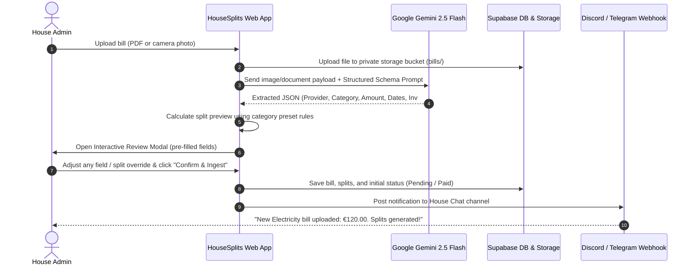
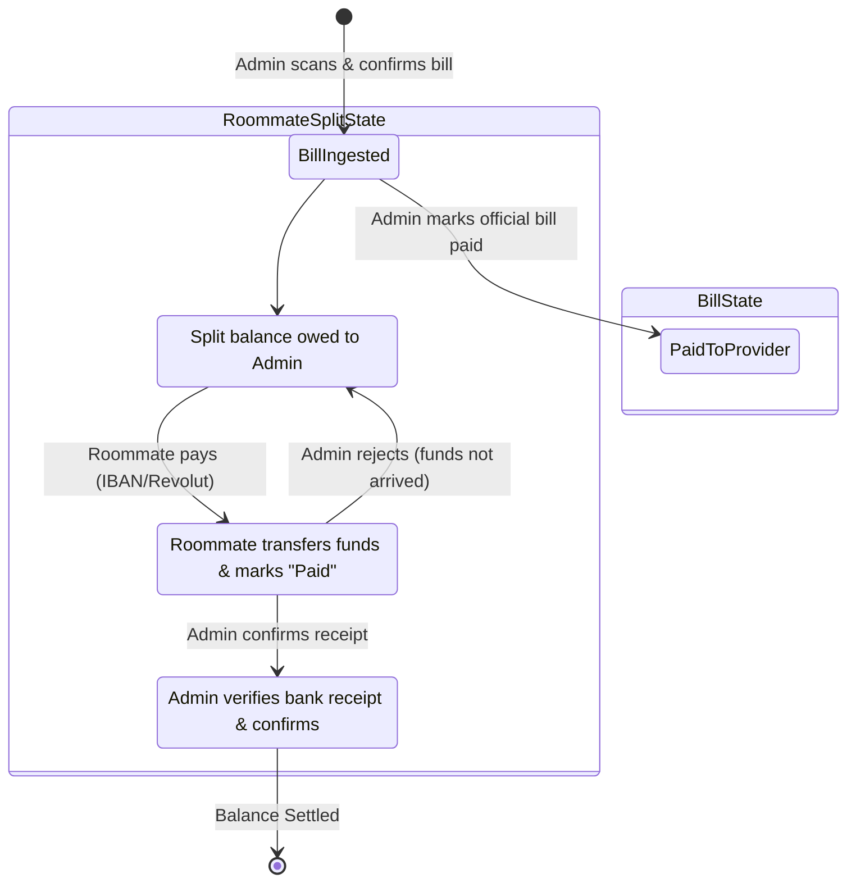
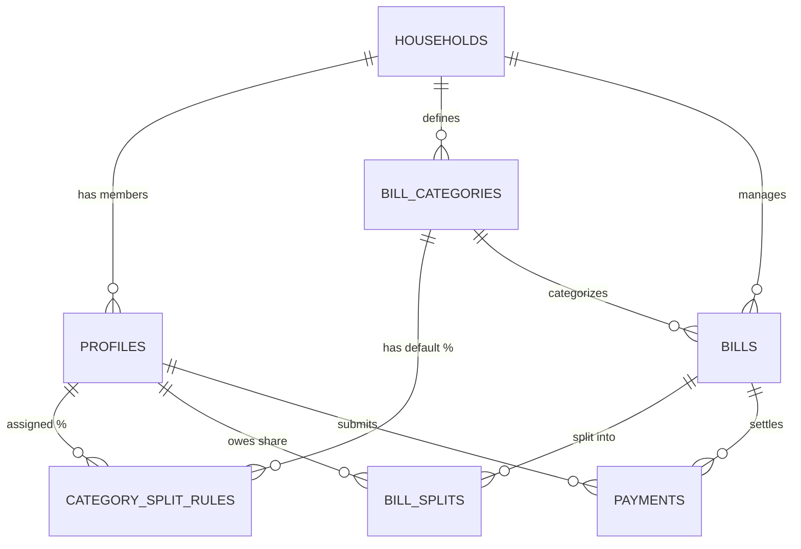

# HouseSplits - Application Specification

**Version:** 1.0.0  
**Status:** Approved Architecture Draft  
**Target Platform:** Mobile-First Responsive Web Application (PWA)  
**Stack:** React + Vite + TypeScript + Tailwind CSS + Supabase (PostgreSQL, Auth, Storage, Edge Functions) + Google Gemini AI API  

---

## 1. Executive Summary & Vision

**HouseSplits** is a modern, mobile-friendly house-sharing and bill-splitting application designed for roommates sharing a home. It eliminates the friction, forgotten payments, and awkward financial conversations common in shared living.

### Core Value Propositions
- **AI-Powered Bill Ingestion:** Upload or photograph utility bills (electricity, water, internet, gas, garbage) and rent statements (PDF or images). Google Gemini AI automatically extracts the service provider, billing period, issue date, due date, invoice number, and exact monetary amount.
- **Granular Custom Split Rules:** Flexible split rules per category. For instance, Rent is split 50% to the primary tenant and 25% each to a couple; while utilities (electricity, water, internet) are split equally (33.33% each).
- **Single Central Payer Model (Admin-Payer):** The House Admin pays the service providers and landlords directly. The application calculates what each roommate owes the Admin, tracks payment transfers, and manages debt reconciliation.
- **Instant Roommate Transparency:** Each roommate has their own account to view current month totals, outstanding balances, upcoming due dates, and the Admin's bank/payment details (IBAN, Revolut, etc.).
- **Automated Webhook Notifications:** Instant alerts to household chat channels (Discord, Telegram, or WhatsApp) when a new bill is ingested, when splits are generated, and when payments are due.

---

## 2. User Roles & Permission Model

| Feature / Action | House Admin | Roommate (Member) |
|---|:---:|:---:|
| Upload & Scan Bills with Gemini AI | ✅ | ❌ (or optional toggle) |
| Review & Confirm Ingested Bills | ✅ | ❌ |
| Configure Category Split Presets | ✅ | ❌ |
| Override Split % on a Specific Bill | ✅ | ❌ |
| Edit Household Settings & Payment Info (IBAN/Revolut) | ✅ | ❌ |
| Mark Bill as "Paid to Provider" | ✅ | ❌ |
| Confirm Roommate's Payment to Admin | ✅ | ❌ |
| View Own Debt, History & Invoices | ✅ | ✅ |
| Mark Own Share as "Paid to Admin" (Upload Transfer Proof) | ✅ | ✅ |
| Download Original Bill PDFs / Receipts | ✅ | ✅ |
| Receive Chat Webhook / In-App Reminders | ✅ | ✅ |

---

## 3. Core Workflows & Life Cycles

### 3.1 Bill Scanning & Ingestion Life Cycle


### 3.2 Payment & Settlement Life Cycle


---

## 4. Split Engine Specifications

### 4.1 Category Split Presets
The household maintains default split configurations per bill category:
- **Rent:** E.g., `User: 50.00%`, `Roommate A: 25.00%`, `Roommate B: 25.00%` (Total = 100%).
- **Electricity:** E.g., `User: 33.34%`, `Roommate A: 33.33%`, `Roommate B: 33.33%` (Total = 100%).
- **Water:** E.g., `User: 33.34%`, `Roommate A: 33.33%`, `Roommate B: 33.33%` (Total = 100%).
- **Internet:** E.g., `User: 33.34%`, `Roommate A: 33.33%`, `Roommate B: 33.33%` (Total = 100%).
- **Groceries / Shared House Supplies:** Configurable equal or custom split.

### 4.2 Exact-Cent Allocation & Rounding Rule
When dividing uneven amounts (e.g. €100.00 divided 3 ways = €33.3333...):
- Calculate each member's exact cent share: `Math.floor(totalAmount * (percent / 100) * 100) / 100`.
- Calculate remainder: `totalAmount - sum(allocatedShares)`.
- Allocate remaining cents (typically 1 or 2 cents) to the designated primary payer (Admin) or member with the highest percentage.
- **Invariant:** The sum of all `bill_splits.amount_due` must *always* equal `bills.total_amount` down to the exact cent.

### 4.3 Per-Bill Override Capability
In the Review Modal, the Admin can:
- Switch between percentage mode (%) and fixed monetary amount mode (€).
- Exclude a roommate (e.g., away for an entire month) and redistribute 100% across the remaining roommates.
- Fine-tune individual shares manually; the UI highlights whether the sum equals the bill total (green indicator) or has a discrepancy (red indicator).

---

## 5. Gemini AI Bill Scanner Specification

### 5.1 Model & API Configuration
- **Model:** `gemini-2.5-flash` (or `gemini-1.5-flash` with fallback)
- **Input Modality:** Multi-modal (Supports PDF documents and image formats `image/jpeg`, `image/png`, `image/webp`, `image/heic`).
- **Response Format:** Forced JSON output schema via `response_mime_type: "application/json"`.

### 5.2 Structured Extraction Schema
```json
{
  "provider_name": "string (e.g. EDP Comercial, Endesa, Vodafone, Landlord)",
  "category_suggestion": "string enum: ['rent', 'electricity', 'water', 'internet', 'gas', 'garbage', 'other']",
  "invoice_number": "string or null",
  "total_amount": "number (exact decimal, e.g. 142.50)",
  "currency": "string (ISO 4217, default 'EUR')",
  "issue_date": "string (YYYY-MM-DD or null)",
  "due_date": "string (YYYY-MM-DD or null)",
  "billing_period": {
    "start_date": "string (YYYY-MM-DD or null)",
    "end_date": "string (YYYY-MM-DD or null)"
  },
  "confidence_score": "number between 0 and 1",
  "notes": "string (brief summary or note on meter readings if present)"
}
```

### 5.3 System Prompt Blueprint
```text
You are a specialized financial document parser for residential household bills.
Your job is to analyze the provided bill image or PDF and extract structured invoice details with extreme accuracy.

Rules:
1. Identify the utility provider name or landlord.
2. Determine the bill category strictly from: rent, electricity, water, internet, gas, garbage, other.
3. Extract the total payable amount. Ensure discounts or previous balance forwards are accounted for and extract the FINAL amount due.
4. Extract the payment due date (the deadline to pay).
5. Extract the billing service period dates (from and to) if clearly indicated.
6. Extract the unique invoice or customer reference number.
7. Return clean JSON matching the specified schema. If any field cannot be determined, return null for that field.
```

---

## 6. Database Schema (Supabase PostgreSQL)

### 6.1 Entity Relationship Overview


### 6.2 Table Definitions (DDL)

```sql
-- 1. Households
CREATE TABLE households (
    id UUID PRIMARY KEY DEFAULT gen_random_uuid(),
    name TEXT NOT NULL DEFAULT 'Our Home',
    currency VARCHAR(3) NOT NULL DEFAULT 'EUR',
    admin_payment_info JSONB DEFAULT '{"iban": "", "revolut": "", "bizum": "", "notes": ""}'::jsonb,
    webhook_settings JSONB DEFAULT '{"discord_url": "", "telegram_bot_token": "", "telegram_chat_id": "", "notify_on_new_bill": true, "notify_on_reminders": true}'::jsonb,
    created_at TIMESTAMPTZ DEFAULT now(),
    updated_at TIMESTAMPTZ DEFAULT now()
);

-- 2. Profiles (Roommates linked to Supabase Auth)
CREATE TABLE profiles (
    id UUID PRIMARY KEY REFERENCES auth.users(id) ON DELETE CASCADE,
    household_id UUID REFERENCES households(id) ON DELETE SET NULL,
    full_name TEXT NOT NULL,
    nickname TEXT,
    avatar_url TEXT,
    role VARCHAR(20) NOT NULL DEFAULT 'member' CHECK (role IN ('admin', 'member')),
    phone_number TEXT,
    is_active BOOLEAN DEFAULT true,
    created_at TIMESTAMPTZ DEFAULT now(),
    updated_at TIMESTAMPTZ DEFAULT now()
);

-- 3. Bill Categories
CREATE TABLE bill_categories (
    id UUID PRIMARY KEY DEFAULT gen_random_uuid(),
    household_id UUID NOT NULL REFERENCES households(id) ON DELETE CASCADE,
    name TEXT NOT NULL, -- e.g. 'Rent', 'Electricity', 'Water', 'Internet'
    code VARCHAR(50) NOT NULL, -- 'rent', 'electricity', 'water', 'internet', 'gas', 'other'
    icon TEXT DEFAULT 'zap',
    color_hex VARCHAR(7) DEFAULT '#3B82F6',
    created_at TIMESTAMPTZ DEFAULT now()
);

-- 4. Category Default Split Rules
CREATE TABLE category_split_rules (
    id UUID PRIMARY KEY DEFAULT gen_random_uuid(),
    category_id UUID NOT NULL REFERENCES bill_categories(id) ON DELETE CASCADE,
    profile_id UUID NOT NULL REFERENCES profiles(id) ON DELETE CASCADE,
    default_percentage NUMERIC(5, 2) NOT NULL CHECK (default_percentage >= 0 AND default_percentage <= 100),
    created_at TIMESTAMPTZ DEFAULT now(),
    UNIQUE(category_id, profile_id)
);

-- 5. Bills
CREATE TABLE bills (
    id UUID PRIMARY KEY DEFAULT gen_random_uuid(),
    household_id UUID NOT NULL REFERENCES households(id) ON DELETE CASCADE,
    category_id UUID NOT NULL REFERENCES bill_categories(id),
    provider_name TEXT NOT NULL,
    invoice_number TEXT,
    total_amount NUMERIC(10, 2) NOT NULL CHECK (total_amount >= 0),
    currency VARCHAR(3) NOT NULL DEFAULT 'EUR',
    issue_date DATE,
    due_date DATE NOT NULL,
    period_start DATE,
    period_end DATE,
    file_path TEXT, -- Supabase Storage object path
    file_type VARCHAR(50), -- 'application/pdf', 'image/jpeg', etc.
    gemini_raw_output JSONB, -- Stored OCR extraction diagnostics
    paid_to_provider BOOLEAN DEFAULT false,
    paid_to_provider_at TIMESTAMPTZ,
    created_by UUID REFERENCES profiles(id),
    created_at TIMESTAMPTZ DEFAULT now(),
    updated_at TIMESTAMPTZ DEFAULT now()
);

-- 6. Bill Splits (Individual roommate owed shares)
CREATE TABLE bill_splits (
    id UUID PRIMARY KEY DEFAULT gen_random_uuid(),
    bill_id UUID NOT NULL REFERENCES bills(id) ON DELETE CASCADE,
    profile_id UUID NOT NULL REFERENCES profiles(id) ON DELETE CASCADE,
    percentage NUMERIC(5, 2) NOT NULL CHECK (percentage >= 0 AND percentage <= 100),
    amount_due NUMERIC(10, 2) NOT NULL CHECK (amount_due >= 0),
    status VARCHAR(20) NOT NULL DEFAULT 'pending' CHECK (status IN ('pending', 'paid_to_admin', 'confirmed_by_admin')),
    marked_paid_at TIMESTAMPTZ,
    confirmed_paid_at TIMESTAMPTZ,
    proof_file_path TEXT,
    notes TEXT,
    created_at TIMESTAMPTZ DEFAULT now(),
    updated_at TIMESTAMPTZ DEFAULT now(),
    UNIQUE(bill_id, profile_id)
);

-- 7. Settlement Payments Log
CREATE TABLE payments (
    id UUID PRIMARY KEY DEFAULT gen_random_uuid(),
    household_id UUID NOT NULL REFERENCES households(id) ON DELETE CASCADE,
    payer_id UUID NOT NULL REFERENCES profiles(id) ON DELETE CASCADE,
    receiver_id UUID NOT NULL REFERENCES profiles(id) ON DELETE CASCADE,
    amount NUMERIC(10, 2) NOT NULL CHECK (amount > 0),
    payment_method VARCHAR(50) DEFAULT 'bank_transfer', -- 'revolut', 'bank_transfer', 'cash', 'other'
    proof_url TEXT,
    status VARCHAR(20) NOT NULL DEFAULT 'pending' CHECK (status IN ('pending', 'confirmed', 'rejected')),
    notes TEXT,
    created_at TIMESTAMPTZ DEFAULT now(),
    confirmed_at TIMESTAMPTZ
);
```

### 6.3 Row Level Security (RLS) Policy Blueprint
- **Profiles:** Users can read all profiles in their `household_id`. Users can update their own profile. Admins can update roommate roles and household memberships.
- **Households:** Roommates can read household details. Only Admins can modify settings, payment details, or webhook URLs.
- **Bills & Splits:** All members in a household can view bills and split allocations. Only Admins can insert/update/delete bills and split configurations. Members can update `marked_paid_at` on their own `bill_splits`. Only Admins can set `confirmed_by_admin`.

---

## 7. User Interface & Screen Wireframes

HouseSplits adopts a clean, high-contrast, dark-first UI with warm accents, optimized for thumb-driven mobile interaction.

### 7.1 Key Navigation Screens
1. **Home / Dashboard (`/`)**
   - **Hero Summary:** Current month overall spending, Admin settlement summary ("You are owed €340.50" or for member: "You owe Admin €85.00").
   - **Due Soon Carousel:** Cards showing upcoming bills with countdown tags (`Due in 3 days`).
   - **Quick Action Bar:** `[+ Scan Bill]` (Prominent floating action button for Admin), `[Pay Admin]` (for Roommates), `[Copy IBAN/Revolut]`.
   - **Recent Activity Feed:** Feed of newly uploaded bills and confirmed payments.

2. **Scanner & Review Modal (`/scan` or Modal)**
   - **Upload Dropzone:** Drag & drop bill or tap "Take Photo" / "Choose File".
   - **Live Progress Indicator:** "Gemini is reading your bill..." with animated shimmer.
   - **Side-by-Side Review:**
     - Left (Desktop) / Top Collapsible (Mobile): Document viewer preview.
     - Right: Extracted Form:
       - Provider Name & Category Selector.
       - Amount & Due Date picker.
       - Interactive Split Preview Table:
         - Row for each roommate showing Photo, Name, Split %, and Computed Share in €.
         - Real-time warning if total != 100%.
     - Primary Action: `[Confirm & Split Bill]`.

3. **Bills & Ledger (`/bills`)**
   - Filter tabs: `All`, `Unsettled`, `Paid to Provider`, `Archived`.
   - Category chips: `Rent`, `Electricity`, `Water`, `Internet`, etc.
   - Bill Card details: Provider logo/icon, invoice date range, total amount, badge showing how many roommates have paid (e.g. `2/3 Settled`).
   - Expandable split detail drawer showing breakdown per roommate with action buttons.

4. **Split Rules Manager (`/settings/splits`)**
   - Interactive matrix of categories vs roommates.
   - Sliders or numeric inputs to set default percentages per category.
   - Auto-balancing helper ("Equalize remaining").

5. **Household & Payment Settings (`/settings/house`)**
   - Admin Payment Info: IBAN, BIC, Revolut `@username`, Bizum number, custom payment instructions.
   - Roommate Management: Invite link generation, active roommate list, permission toggles.
   - Webhooks: Discord / Telegram webhook URL inputs with a "Send Test Notification" button.

---

## 8. Webhook Notification Payloads

### 8.1 Discord Webhook Payload (New Bill Ingested)
```json
{
  "username": "HouseSplits Bot",
  "avatar_url": "https://housesplits.app/icon.png",
  "embeds": [
    {
      "title": "⚡ New Utility Bill Uploaded",
      "description": "**Provider:** EDP Comercial\n**Category:** Electricity\n**Total Amount:** €120.00\n**Due Date:** Oct 25, 2026",
      "color": 3901686,
      "fields": [
        { "name": "Will (50%)", "value": "€60.00", "inline": true },
        { "name": "Mate A (25%)", "value": "€30.00", "inline": true },
        { "name": "Mate B (25%)", "value": "€30.00", "inline": true }
      ],
      "footer": { "text": "HouseSplits • Check app to view invoice & transfer details" }
    }
  ]
}
```

---

## 9. Security & Privacy Architecture

1. **Gemini API Key Protection:**
   - The Gemini API key is stored securely in environment variables (server-side via Supabase Edge Function or Vite backend proxy). The client web app never exposes the Gemini API key in client-side bundles.
2. **Encrypted Document Storage:**
   - Bills and payment proofs are stored in a private Supabase Storage bucket with signed URLs expiring after 60 minutes for authenticated household members only.
3. **Auditability:**
   - All balance changes, overrides, and payment confirmations record `created_at` and `updated_at` with user IDs to avoid disputes between roommates.

---

## 10. Implementation Phasing & Milestones

- **Phase 1: Project Initialization & Supabase Setup**
  - Setup Vite + React 19 + TypeScript + Tailwind CSS project.
  - Setup Supabase project, execute database DDL migrations, seed default categories.
- **Phase 2: Authentication & Household Configuration**
  - Roommate login & invite flow.
  - Category split rules manager with 100% balance validation.
  - Admin payment info configuration.
- **Phase 3: Gemini Bill Scanner & Review Modal**
  - Supabase Edge Function or backend endpoint for multi-modal Gemini 2.5 Flash parsing.
  - File upload component (drag-and-drop / mobile camera capture).
  - Split calculation engine with exact-cent remainder attribution.
  - Review and confirm modal.
- **Phase 4: Bill Ledger & Payment Settlement Flow**
  - Dashboard with summary metrics (Total monthly expenses, what is owed to Admin).
  - Roommate payment tracking ("Mark Paid to Admin" + Admin "Confirm Payment").
  - Filterable Bills Ledger.
- **Phase 5: Webhook Dispatcher & PWA Polish**
  - Discord/Telegram webhook dispatch on new bill and payment confirmations.
  - PWA manifest, offline cache icons, mobile responsive touch polish.
