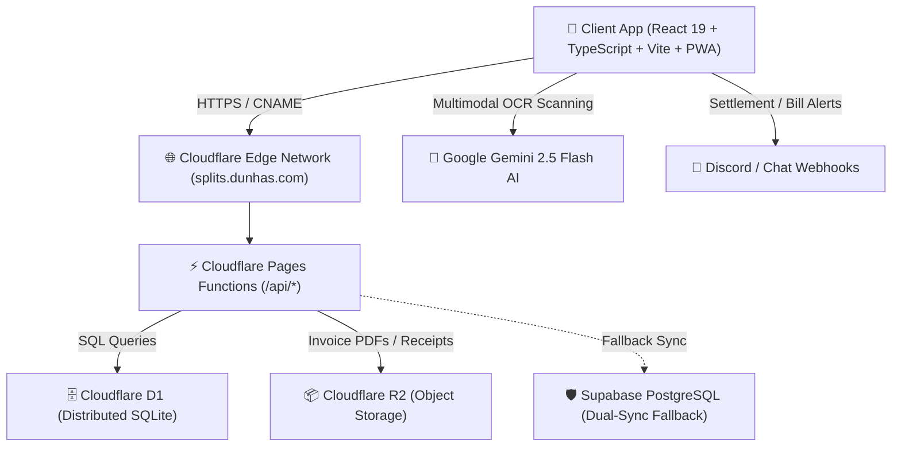

# 🏠 HouseSplits

[](https://splits.dunhas.com/)
[](https://pages.cloudflare.com/)
[](https://developers.cloudflare.com/d1/)
[](https://aistudio.google.com/)
[](https://react.dev/)
[](https://www.typescriptlang.org/)

**HouseSplits** is a modern, responsive, mobile-first Web Application and Progressive Web App (PWA) built for shared households and roommates. 

It leverages **Google Gemini 2.5 Flash** multimodal AI to scan utility bills and invoices (electricity, water, gas, internet, rent), automatically extracting providers, amounts, and dates, and dividing expenses using a cent-accurate percentage split rules engine.

---

## 🏗️ Complete Technology Stack

HouseSplits is built on a **100% serverless, edge-first architecture** deployed natively across Cloudflare's global network, with zero virtual machines or legacy servers to maintain.



### 1. Frontend & Client
- **Framework:** [React 19](https://react.dev/) + [TypeScript 5.7](https://www.typescriptlang.org/)
- **Bundler & Tooling:** [Vite 6](https://vitejs.dev/) with hot module replacement and tree-shaking
- **Styling & Design System:** [Tailwind CSS 3.4](https://tailwindcss.com/) with a dark-first glassmorphism theme, DM Sans typography, and high-density financial cards
- **Icons:** [Lucide React](https://lucide.dev/)
- **Visual Polish:** [Canvas Confetti](https://www.npmjs.com/package/canvas-confetti) for payment celebrations, micro-animations, and responsive modals
- **PWA Capabilities:** Service worker & web app manifest configured via `vite-plugin-pwa` for mobile home screen installation

### 2. Backend & Serverless Edge (Cloudflare Native)
- **Edge Runtime:** [Cloudflare Pages Functions](https://developers.cloudflare.com/pages/functions/) running on V8 isolates worldwide
- **Edge Database:** [Cloudflare D1](https://developers.cloudflare.com/d1/) (`housesplits-db`) — distributed, ACID-compliant relational SQL powered by SQLite
- **Edge Storage:** [Cloudflare R2](https://developers.cloudflare.com/r2/) (`housesplits-storage`) — S3-compatible, zero-egress object storage for invoice PDFs and payment receipts
- **Authentication & Security:** Native PBKDF2 password derivation with cryptographically signed HMAC-SHA256 JWT sessions stored in `HttpOnly`, `Secure`, `SameSite=Lax` cookies, with automatic `Bearer` header token fallback
- **Edge Routing & SSL:** Cloudflare Proxied DNS (`CNAME` -> `housesplits.pages.dev`) with Universal SSL/TLS and DDoS mitigation

### 3. AI & Intelligent Document Processing
- **Model:** [Google Gemini 2.5 Flash](https://ai.google.dev/) (`@google/genai` SDK)
- **Capabilities:** Multimodal document scanning supporting Portuguese, Spanish, and English utility invoices (EDP, Endesa, Vodafone, MEO, etc.)
- **Extraction:** Automatically parses Total Amount, Invoice Number, Billing Period, Due Date, and Provider Name

### 4. Dual-Database Compatibility
- **Primary:** Cloudflare D1 (`housesplits-db`)
- **Secondary / Fallback:** Supabase PostgreSQL (`supabase/schema.sql`) for local development flexibility or external analytics

---

## 👥 Multi-Tenancy & User Roles

HouseSplits implements a multi-tenant role hierarchy designed for real-world shared living:

| Role | Scope | Permissions |
| :--- | :--- | :--- |
| **System Manager** | **Global (Platform)** | • Decoupled from individual households (`household_id = null`)<br>• Access to global **System Manager Portal**<br>• Create, inspect, and delete tenant households<br>• Promote/demote user roles across the platform<br>• Manage all users globally |
| **House Admin** | **Household** | • Configures household settings & currency (EUR, USD, GBP, etc.)<br>• Sets up payment details (IBAN, Revolut tag, Bizum phone)<br>• Scans bills using Gemini AI or enters expenses manually<br>• Configures category split percentages (Rent, Utilities, etc.)<br>• Confirms roommate payments with one click |
| **Member (Roommate)** | **Household** | • Views household balance, monthly summaries, and pending bills<br>• Accesses admin bank/transfer details for easy payment<br>• Marks individual split shares as "Paid to Admin"<br>• Views PDF and image attachments for all ingested invoices |

---

## ✨ Key Features

- **⚡ Google Gemini AI Bill Scanner:** Drag and drop invoice PDFs, JPGs, or PNGs. Gemini extracts data in under 2 seconds and pre-fills an interactive verification modal.
- **⚖️ Cent-Accurate Split Engine:** Divides bills by custom percentages (e.g. 50/25/25 for Rent, 33.34/33.33/33.33 for Utilities) and automatically allocates the 1-cent remainder so the total always matches the invoice exactly.
- **💳 Centralized Admin Settlement:** The house admin pays utility companies; roommates settle their balance directly with the admin via displayed payment credentials.
- **🔗 Instant Invite System:** Generate unique invite codes (e.g., `HOUSE-QN5C`) or shareable one-click WhatsApp/chat links for roommates.
- **🔔 Discord / Chat Webhooks:** Automatic notifications dispatched to household channels whenever a new bill is scanned or a payment is confirmed.
- **📊 Monthly Ledger & Filters:** Filter expenses by month, category, payment status, or specific roommate.

---

## 📡 Edge API Architecture (`/functions/api/*`)

All backend APIs are Cloudflare Pages Functions deployed alongside the static application:

```
functions/
├── _auth.ts                    # PBKDF2 hashing, JWT signing, cookie parsing
├── api/
│   ├── auth/
│   │   ├── login.ts            # POST /api/auth/login (JWT cookie + token response)
│   │   ├── signup.ts           # POST /api/auth/signup (Registration & household join)
│   │   ├── session.ts          # GET /api/auth/session (Active user verification)
│   │   └── logout.ts           # POST /api/auth/logout (Clears session cookie)
│   ├── households/
│   │   ├── index.ts            # GET (list all), POST (create household)
│   │   └── [id].ts             # GET, PUT (update info/settings), DELETE
│   ├── profiles/
│   │   ├── index.ts            # GET (by house or all), POST (create profile)
│   │   └── [id].ts             # PUT (role/house change), DELETE (profile purge)
│   ├── bills/
│   │   ├── index.ts            # GET (by house), POST (new bill + splits)
│   │   ├── [id].ts             # PUT (paid status/details), DELETE
│   │   └── [id]/splits/[splitId].ts # PUT (mark paid, confirm settlement)
│   └── upload.ts               # POST (R2 storage file upload for invoices)
```

---

## 📂 Project Directory Structure

```
HouseSplits/
├── d1/
│   └── schema.sql              # Cloudflare D1 SQL schema & indices
├── functions/                  # Cloudflare Pages Functions (Serverless Edge Backend)
│   ├── _auth.ts
│   └── api/                    # REST API endpoints (Auth, Households, Bills, Profiles)
├── public/                     # Static assets (Favicons, PWA icons)
├── src/
│   ├── components/
│   │   ├── auth/               # Login & Registration screen
│   │   ├── bills/              # BillList, BillCard, ManualBillModal
│   │   ├── dashboard/          # BalanceOverview, DueSoonList, StatsCards
│   │   ├── layout/             # Navbar, MobileNav, Footer
│   │   ├── roommates/          # RoommateManagerModal, InviteCodeCard
│   │   ├── scanner/            # BillScannerModal, GeminiReviewModal
│   │   ├── settings/           # SplitRulesManager, HouseholdSettingsModal
│   │   ├── settlement/         # PaymentInfoModal, ReceiptViewer
│   │   └── system/             # SystemManagerPortal, HouseholdManager, UserManager
│   ├── context/
│   │   └── HouseholdContext.tsx# Core React context & unified state engine
│   ├── lib/
│   │   ├── apiClient.ts        # Native Cloudflare API client
│   │   ├── authService.ts      # Authentication coordinator (Cloudflare + Supabase)
│   │   ├── gemini.ts           # Google Gemini 2.5 Flash SDK integration
│   │   ├── supabase.ts         # Fallback client configuration
│   │   └── webhooks.ts         # Discord / chat webhook dispatchers
│   ├── types/
│   │   └── index.ts            # TypeScript domain models & interfaces
│   ├── App.tsx                 # Root application routing & role guards
│   ├── index.css               # Tailwind CSS & design tokens
│   └── main.tsx                # React root entry point
├── supabase/
│   └── schema.sql              # PostgreSQL schema for Supabase fallback
├── package.json                # Dependencies & build scripts
├── tsconfig.json               # TypeScript configuration
├── vite.config.ts              # Vite & PWA build configuration
└── README.md                   # Project documentation
```

---

## 🚀 Local Development

### 1. Clone & Install
```bash
git clone https://github.com/Srlimao/house-splits.git
cd house-splits
npm install
```

### 2. Environment Setup
Create a `.env` file in the project root:
```env
# Google Gemini 2.5 Flash OCR
VITE_GEMINI_API_KEY=your_gemini_api_key_here

# Cloudflare D1 & Pages Token (for local deployments)
CLOUDFLARE_API_TOKEN=your_cloudflare_api_token_here

# Supabase (Optional fallback)
VITE_SUPABASE_URL=https://your-project.supabase.co
VITE_SUPABASE_ANON_KEY=your_anon_key_here
```

### 3. Run Development Server
```bash
npm run dev
```
Open [http://localhost:3000](http://localhost:3000) in your browser.

---

## 🚢 Production Deployment

The application compiles into a single static distribution (`dist/`) paired with Cloudflare Pages Functions:

### 1. Build Production Bundle
```bash
npm run build
```

### 2. Deploy to Cloudflare Pages
```bash
# Using Wrangler CLI
npx wrangler pages deploy dist --project-name=housesplits
```

### 3. Remote D1 Database Migrations
To execute schema updates against remote Cloudflare D1:
```bash
npx wrangler d1 execute housesplits-db --remote --file=./d1/schema.sql
```

---

## 📄 License

This project is licensed under the MIT License.
